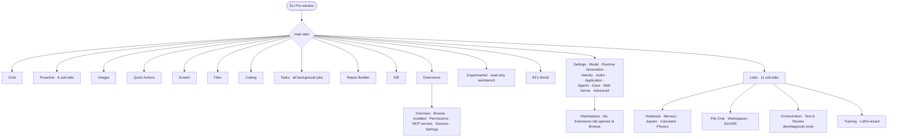

# ELI GUI

> **Updated for 3.0.175.** Ollama model selector fixed on packaged builds
> (`QDialogButtonBox` exported via `eli/gui/qt_compat.py`).

`eli/gui/` — 28.2k LOC across 59 modules (top-level launcher, `main_window/` package, `labs/` package, panels, tabs, docks, widgets). A full native PySide6/PyQt desktop app (with a
Qt-binding compat shim), plus a first-boot launcher and a large scientific
"Labs" workspace.

## Tab map

### Marketplace and training additions

| Surface | Where | What it is |
|---|---|---|
| 🎓 **Training** | Labs sub-tab | four-step LoRA wizard: Hardware → Target → Data → Train |
| 🛒 **Marketplace** | Extensions tab; also shown under Settings | community plugins: browse, verify, scan, install, permissions, sources |
| **Permission dialog** | anywhere | Android-style consent: Allow once · Always allow · Not now · Never allow |
| 🎯 **Eval board** / ⚖️ **Eval + judge** | Labs ▸ Test & Review | behaviour regression board, run in-process |

## Files

| File | LOC | Role |
|---|---:|---|
| `app.py` | 369 | launcher, load plan for the chosen model, entry `main()` |
| `main_window/window.py` | 1178 | `EliMainWindow` and `main()`, composed from the mixins below |
| `main_window/_mixins/settings_model.py` | 3131 | settings pages and model loading |
| `main_window/_mixins/chrome_io.py` | 2095 | window chrome, input/output plumbing |
| `main_window/_mixins/tabs.py` | 1675 | builds the main tabs |
| `main_window/_mixins/conversation.py` | 1268 | chat turn handling; commands that need no model (`_run_now`) |
| `main_window/_mixins/features.py` | 910 | feature toggles and panels |
| `main_window/models.py` | 315 | `LocalModelManager`, `OllamaModelManager` |
| `main_window/adapters.py` | 260 | `CentralMemoryAdapter`, `ExecutorBridge` |
| `main_window/widgets.py`, `_common.py` | 450, 555 | shared widgets and helpers |
| `labs/` (16 modules) | 5.8k | the Labs sub-tabs; `report_tab.py` is the largest (3212) |
| `panels/startup.py` | 2186 | guided first boot: hardware, model pick or download, tuning |
| `panels/settings.py` | 652 | settings dialog: Agents, Models, Cognition, Marketplace, Self-Upgrade |
| `tabs/extensions_tab.py` | 2024 | Extensions tab: plugins, MCP servers and the marketplace; the same widget is the Settings ▸ Marketplace page |
| `tabs/training_tab.py` | 841 | Labs ▸ Training, the LoRA wizard |
| `panels/permission_dialog.py` | 232 | plugin consent dialog and its thread bridge |
| `docks/operator_console_dock.py` | 294 | operator console dock |
| `widgets/ollama_model_selector.py` | 509 | optional Ollama model picker |
| `license_dialog.py` | 253 | licence activation and purchase dialogs |
| `off_thread.py` | 41 | blocking work off the window's thread |

## Launcher (`app.py`)

The entry path: `_auto_tune(model_path)` (the load plan `gguf_inference.load_model` uses,
from `core/load_plan.py`, as the values the setup screen shows and saves), `_pick_model`,
`_confirm_params`, config load/save. `main()` runs the licence gate, the first-run database
bootstrap and the bundle chooser, then either hands over to the window, whose startup model
picker is shown (`show_startup_model_picker`), or loads the saved model and then calls
`main_window.main()`. `--setup` forces the terminal setup.

In a packaged build the entry is `packaging/pyinstaller/eli_entry.py`, which keeps one window
at a time with an OS file lock (`_gui_singleton_or_exit`); a second start exits. The lock is
released by the system when the process ends, however it ends.

## Main window (`main_window/`)

`EliMainWindow` in `window.py` is composed from the mixins under `_mixins/`. The classes below
live beside it and are application logic, not just UI:
- `CentralMemoryAdapter` — bridges the GUI to the memory subsystem.
- `LocalModelManager` (`models.py`) — discover/load/swap local GGUF models.
- `OllamaModelManager` (`models.py`) — optional Ollama integration (legacy/optional;
  ELI's stance is 100% local GGUF, so this is a secondary path).
- `ExecutorBridge` (`adapters.py`) — routes GUI actions into the executor/engine.
- UI widgets: `_QABoard` (quick-action card board), `_MiniTelemetryGraph` (live
  telemetry), `_ZoomableSettingsView`, `_ZoomableImagePreview`, `_FlowLayout`,
  `_CapabilityList`.
- `pyqtSignal`/`Slot` aliased through `qt_compat.py` so it runs on PyQt **or**
  PySide.

Threading: every long-running worker in this file marshals results back to
the GUI thread via a class-level `pyqtSignal` connected with an explicit
`Qt.ConnectionType.QueuedConnection` — the safe cross-thread pattern (same
one Training already used correctly, see below). Two screen-control call
sites (OCR results, "ask ELI" results) used `QTimer.singleShot(0, ...)`
called *from* the worker thread instead, which has no guaranteed event loop —
fixed to use the same signal pattern as the neighbouring capture handler.

### The status-bar confidence/grounding badge

`_update_confidence_meta_label()` (`main_window/_mixins/conversation.py`) reads
`CognitiveEngine._last_request_meta`, refreshed once per turn via the
`_conf_meta_update_sig` signal fired at the end of the send-message worker. Two gaps let it
show stale or wrong numbers:

- The GUI always calls `process(..., stream=True)`, regardless of reasoning mode. A
  chain-of-thought/tree-of-thoughts/constitutional-AI/self-consistency turn runs its passes as
  discrete non-streaming GGUF calls, so `_run_internal_orchestrator` returns a plain dict, not a
  generator — `stream=True` with a non-generator result matched neither of the function's two
  meta-publish branches, so `_publish_orchestrator_turn_meta` was never called and the badge kept
  whatever an earlier, unrelated turn had left in it (observed: a 0.94-scoring CoT reply left the
  badge reading "0.00 (phatic_light)" from a prior greeting). Fixed by unifying the branch
  condition around whether the result actually is a generator, not just whether streaming was
  requested.
- Separately, the streaming/phatic meta-publish block (`kernel/stages/generation.py`) computed
  the turn's real Stage-12 response score but then discarded it, publishing the agent-bus
  aggregate confidence instead — which is genuinely 0.0 on a phatic turn, since the agent bus is
  deliberately skipped for those. Fixed by publishing the Stage-12 score.

See `tests/test_confidence_badge_reflects_the_real_turn.py`.

### Conversation mode and the voice controls

The chat row's **💬 Converse** button (or *"let's have a conversation"* said or typed) turns on
conversation mode (`eli/perception/conversation.py`, wired in `ConversationMixin`): the microphone
listens with no wake word for each turn, each turn runs in the fast reasoning mode
(`canonical_mode("fast")`, i.e. Quick, whatever the picker says), and the reply is spoken while it
is streamed (`speech_stream.SpeechStream`, fed from the turn worker's tokens; at the engine's
`__MAIN_REPLY_DONE__` the worker waits until the reply has been heard, so a turn the user cuts off is
closed unstored and recorded as far as it was heard). A label beside the button shows the state
(👂 Listening, 💭 Thinking, 🗣 Speaking, ⏸ Paused, and "no microphone: type to talk" when the
listener is not running); the label after it shows the voice as set now (voice, pace, level,
tone). Everything said or typed goes through `Conversation.heard` first (`_take_message`): a
conversation or voice control ("wait", "go on", "stop", "speak slower", "use the British voice", "stop
the conversation") is carried out there and never reaches the engine; a spoken turn while a reply is
being written or spoken cancels it (`_request_generation_cancel`) and is the next turn; a typed one
waits its turn as before. Typing in the chat box counts as the user being there for the idle end. The
voice picker follows a spoken voice change. Offscreen test: `tests/test_conversation_mode.py`
(`tests/_gui_runtime_checks.py converse`).

**Settings ▸ Audio**: *Automatic sensitivity* (on by default) uses the room's own speech gate
(`noise_floor.py`); off, the *Speech level (manual)* number is used. A live meter shows the mic's
level against the gate and the room's level. The wake card has the **wake phrase** (applied at once
and the detector trained on it in the background), the wake detector's status (trained when, clips
of the owner's wake word kept from use, how many since the last training) and *echo cancellation*
(PipeWire's, run by ELI for itself; its state or why it is off). All are saved in the settings
(`stt_sensitivity_auto`, `stt_energy_threshold`, `stt_echo_cancel`; the phrases in
`models/wakeword/wake_config.json`).

### Commands that need no model

`ConversationMixin._needs_no_model` asks the engine whether a message is a command it runs
without the model (pause, next, "volume 40%"). Such a command goes through `_run_now`: the
engine on its own thread, at once, while a reply is coming, while the model loads, and when no
model is loaded at all. Anything else with no model loaded gets the "no model is loaded"
notice.

## Labs workspace (`labs/`)

The "scientific workspace" tab (`labs/container.py` builds it) with **11 sub-tabs**: Notebook, Memory &
Conversations, Jupyter, Calculator, Physics constants, File Chat, Workspaces,
Sim/IDE, **Orchestration**, **Test & Review**, **Training**. (Report Builder is its own main tab; Orchestration and Test & Review live in Labs as developer and diagnostic tools.) This is the research-bench surface (reflects whatever technical/research work
the active user does, surfaced dynamically from their own data).

### Labs ▸ 🎓 Training (`tabs/training_tab.py`)

The GUI half of the LoRA pipeline. Four steps: Hardware → Target → Data → Train.
Training reaches the GUI through **signals only** on a **QThread** with cancel.

### Extensions and Settings ▸ 🛒 Marketplace (`tabs/extensions_tab.py`)

One widget, `ExtensionsTab`: the Extensions main tab, and the Settings dialog's Marketplace
page, which is the same widget opened at Browse. Its pages: **Overview**, **Browse**,
**Installed**, **Permissions**, **MCP servers**, **Sources**, **Settings**. See `security.md` for the verification and scanning
model — the short version is that the install path is deliberately slow, nothing is
written to disk before the operator has seen a scan result, and what is written
arrives switched off with no permissions granted.

### The consent dialog (`panels/permission_dialog.py`)

Android-style runtime permission: **Allow once · Always allow · Not now · Never allow**.
`ConsentBridge` marshals worker-thread requests onto the GUI thread with a bounded
timeout that **denies** if the GUI never answers.

## Other surfaces

- `panels/startup.py` — guided first-boot: detect hardware → pick/download a GGUF.
- `panels/agent_wizard.py` — edit agent metadata via `AgentSpec`.
- `docks/operator_console_dock.py`, `docks/proactive_dock.py`.
- `widgets/ollama_model_selector.py`, `tabs/experimental_tab.py`, `tabs/eli_world_tab.py`.

## Honest assessment

- **Strong:** genuine feature-rich desktop product — dockable panels, quick-action board,
  live telemetry, local model management, first-boot wizard, scientific workspace.
  v3 decomposition makes the GUI easier to navigate and test than the v2 god-file.
- **Weak / watch:**
  1. **One window, built in a test.** The pre-decomposition single-file copy was removed
     (2026-10-07): ports kept landing in it instead of `main_window/`, and an import clean-up of
     `_common.py` had left the launched window unable to start with every test passing.
     `tests/test_gui_names_resolve.py` now resolves every name the modules use through their
     `import *`, checks every `self.` method the window calls, and builds the window offscreen.
  2. **Ollama manager** (in `main_window/models.py`, plus the model selector widget) sits oddly against the "100% local GGUF,
     don't-care-about-Ollama" stance — it's an optional/legacy path carrying
     real weight; candidate for removal or clear quarantine.
  3. UI logic instantiating engine/memory directly makes a clean headless mode
     harder (there *is* `eli --headless`, but the GUI module re-implements
     bridges rather than sharing one service layer).

### Marketplace panes and the one-click path

Browse carries two buttons on purpose. **⬇ Install** is the one-click path — it
downloads to memory, checks the checksum and signature, runs every scanner, and then
either installs (when nothing needs deciding) or opens the full review dialog with
scan results pre-filled.
