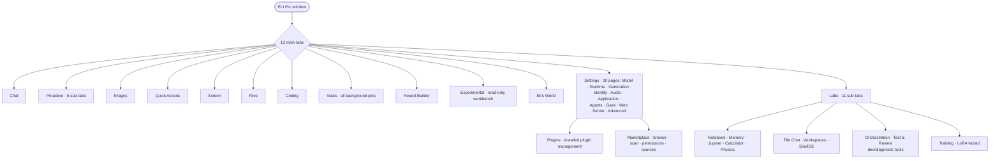

# ELI GUI

> **Updated for 3.0.82.** v3 decomposed the v2 GUI monolith into packages.
> Ollama model selector fixed on packaged builds (`QDialogButtonBox` via
> `eli/gui/qt_compat.py`).

`eli/gui/` — **27,612 LOC**, **61 modules** (decomposed packages + panels/tabs/docks/widgets).
A full native PySide6/PyQt desktop app (with a Qt-binding compat shim), plus a
first-boot launcher and a scientific **Labs** workspace in `eli/gui/labs/`.

## Tab map (current — 13 main tabs)

### New in 2.3.7

| Surface | Where | What it is |
|---|---|---|
| 🎓 **Training** | Labs sub-tab | four-step LoRA wizard: Hardware → Target → Data → Train |
| 🛒 **Marketplace** | Settings sub-tab | community plugins: browse, verify, scan, install, permissions, sources |
| **Permission dialog** | anywhere | Android-style consent: Allow once · Always allow · Not now · Never allow |
| 🎯 **Eval board** / ⚖️ **Eval + judge** | Labs ▸ Test & Review | behaviour regression board, run in-process |

## Files (v3 layout — measured 2026-08-29)

| Package / file | LOC | Role |
|---|---:|---|
| **`main_window/`** (16 files) | ~12,570 | Decomposed main window: mixins, adapters, models, widgets |
| `main_window/window.py` | 1,154 | `EliMainWindow` shell |
| `main_window/adapters.py` | — | `CentralMemoryAdapter`, `ExecutorBridge`, `_GUIEngineAdapter` |
| `main_window/models.py` | — | `LocalModelManager`, `OllamaModelManager` |
| **`labs/`** (17 files) | ~5,964 | Scientific workspace — one module per sub-tab |
| `labs_tab.py` | 30 | **Shim only** — re-exports from `eli.gui.labs` |
| `app.py` | 704 | launcher / first-boot auto-tune / entry `main()` |
| `panels/startup.py` | 1,305 | model picker + FirstBootWizard |
| `panels/settings.py` | 733 | settings dialog incl. Plugins + Marketplace |
| `tabs/training_tab.py` | 841 | Labs ▸ Training — LoRA wizard |
| `tabs/marketplace_tab.py` | 707 | Settings ▸ Marketplace |
| `panels/permission_dialog.py` | 223 | plugin consent dialog |
| `docks/operator_console_dock.py` | 303 | operator console dock |
| `widgets/ollama_model_selector.py` | 294 | optional Ollama model picker |

## Launcher (`app.py`)

The entry path: `_detect_hardware` (queries **free** VRAM — the display server
consumes VRAM before ELI launches, so free ≠ total), `_auto_tune(model_path, hw)`
(picks n_ctx/layers/batch), `_pick_model`, `_confirm_params`, config load/save.
`main()` either shows the startup model picker (first boot) or delegates to
`eli.gui.main_window.window.main()`. `--setup` forces the wizard.

## Main window (`main_window/`)

v3 split the former ~12.6k-line monolith into a package:

- **`window.py`** — `EliMainWindow` and tab wiring.
- **`_mixins/`** — feature slices (chat, settings, quick actions, screen capture, …).
- **`adapters.py`** — bridges to memory, executor, and engine (`CentralMemoryAdapter`,
  `ExecutorBridge`, `_GUIEngineAdapter`).
- **`models.py`** — `LocalModelManager`, `OllamaModelManager`.
- **`widgets.py`** — `_QABoard`, `_MiniTelemetryGraph`, zoomable views, `_CapabilityList`.

## Labs workspace (`labs/`)

The former ~5.7k-line `labs_tab.py` monolith is now **`eli/gui/labs/`** — 17 modules,
~6k LOC total, one file per sub-tab: Notebook, Memory & Conversations, Jupyter,
Calculator, Physics, File Chat, Workspaces, Sim/IDE, Orchestration, Test & Review,
Training, Report Builder. `labs_tab.py` remains a **30-line compatibility shim** for
existing imports.

### Labs ▸ 🎓 Training (`tabs/training_tab.py`)

The GUI half of the LoRA pipeline. Four steps: Hardware → Target → Data → Train.
Training reaches the GUI through **signals only** on a **QThread** with cancel.

### Settings ▸ 🛒 Marketplace (`tabs/marketplace_tab.py`)

Four panes: **Browse**, **Installed**, **Permissions**, **Sources**. See `security.md`
for the verification and scanning model.

### The consent dialog (`panels/permission_dialog.py`)

Android-style runtime permission: **Allow once · Always allow · Not now · Never allow**.
`ConsentBridge` marshals worker-thread requests onto the GUI thread with a bounded
timeout that **denies** if the GUI never answers.

## Other surfaces

- `panels/startup.py` — guided first-boot: detect hardware → pick/download a GGUF.
- `panels/agent_wizard.py` — edit agent metadata via `AgentSpec`.
- `docks/operator_console_dock.py`, `docks/proactive_dock.py`.
- `widgets/ollama_model_selector.py`, `tabs/experimental_tab.py`, `tabs/eli_world_tab.py`.

## Honest assessment

- **Strong:** genuine feature-rich desktop product — dockable panels, quick-action board,
  live telemetry, local model management, first-boot wizard, scientific workspace.
  v3 decomposition makes the GUI easier to navigate and test than the v2 god-file.
- **Weak / watch:**
  1. **`memory.py`-scale coupling** — adapters still instantiate engine/memory directly;
     a shared service layer would help headless mode.
  2. **Ollama manager** — optional/legacy path carrying real weight; candidate for
     quarantine or removal.
  3. **`main_window/` mixins** — still large collectively (~12.6k); continue splitting
     by tab/feature as touch points arise.

### Marketplace panes and the one-click path

Five panes: **Browse**, **Installed**, **Permissions**, **MCP servers**, **Sources**.

Browse carries two buttons on purpose. **⬇ Install** is the one-click path — it
downloads to memory, checks the checksum and signature, runs every scanner, and then
either installs (when nothing needs deciding) or opens the full review dialog with
scan results pre-filled.
